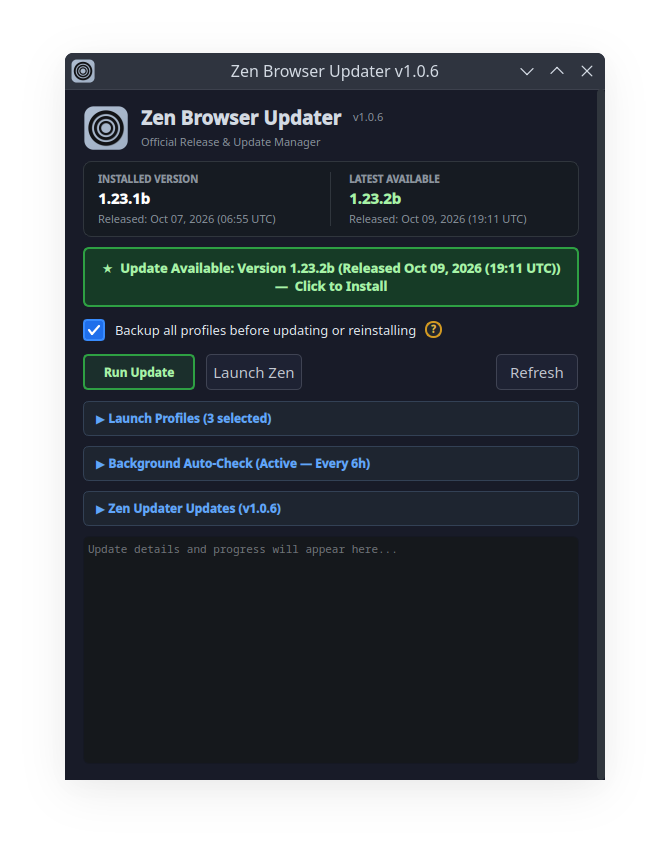
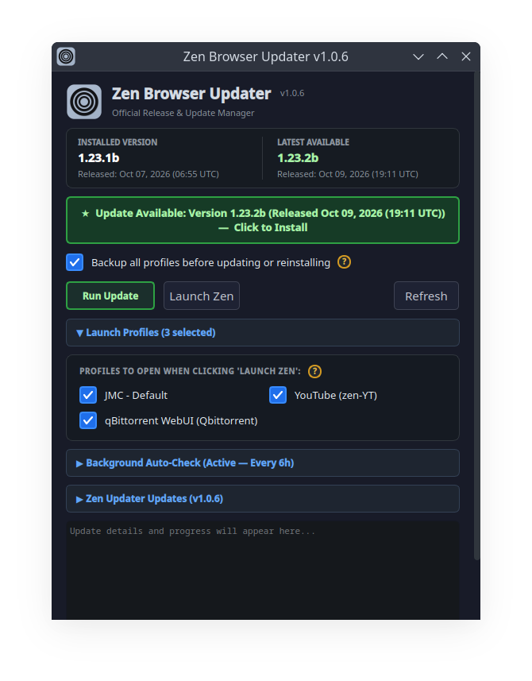
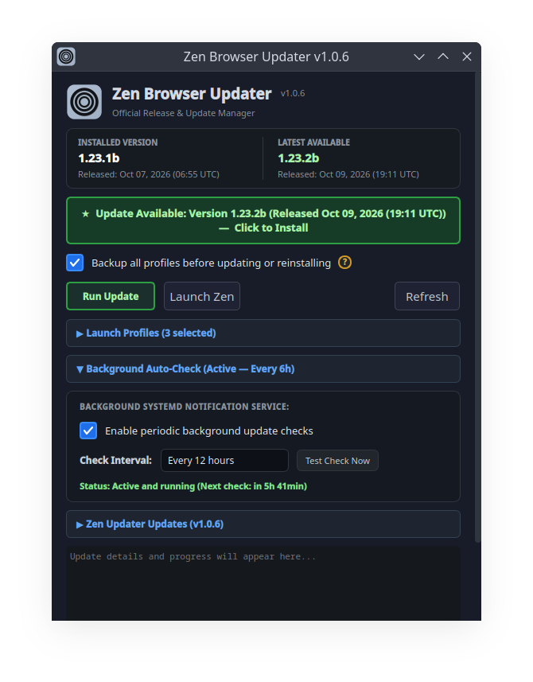
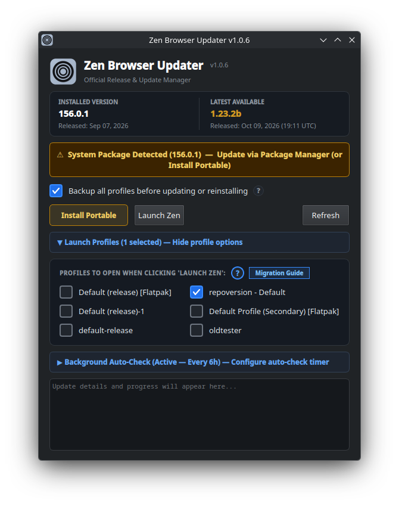
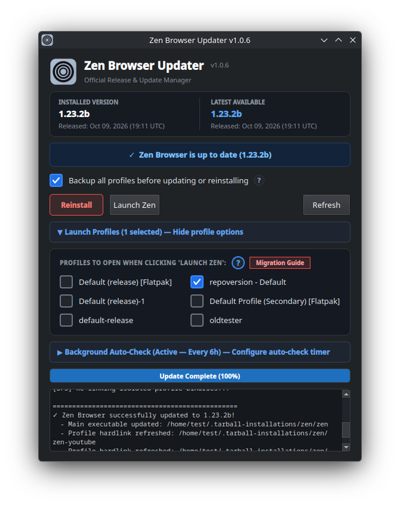
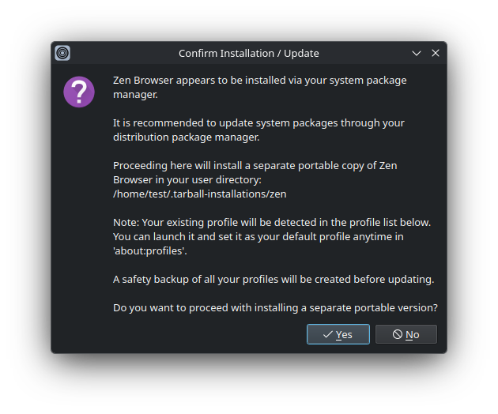

# Zen Browser Updater & Background Notification Service

A native desktop update manager, profile launcher, and background notification service for Zen Browser on Linux.

---

Zen Browser distributes official portable Linux tarballs directly on GitHub. This tool is built specifically to download, manage, and update the official portable release directly from GitHub releases—it does not use or rely on system package managers. If you currently have an existing installation from Flatpak or a distribution package, this tool provides built-in profile migration so you can safely transition to the official portable release while keeping and continuing to use all your existing profiles:

1. **Zen Updater GUI (`zen_updater_gui.py`)**: A native PyQt6 desktop application to inspect official releases, create safety snapshots, download and update the portable browser, guide profile migration from existing Flatpak/system installs, and launch multi-profile browser workflows.
2. **Safe Update Engine (`update_zen.sh`)**: A bash script that gracefully closes running instances, snapshots profile databases, fetches official release tarballs directly from GitHub, and restores custom profile binary hardlinks.
3. **Background Update Checker (`check_zen_update.sh`)**: A lightweight background monitor triggered by systemd that queries GitHub releases, sends non-intrusive desktop notifications when updates are available, and tracks notification IDs to prevent notification spam.

---

### Application Overview

<p align="center">
  
</p>

| Expanded Sections | Self-Updater & Timer |
| :---: | :---: |
|  |  |

### Repository & Package Detection

<p align="center">
  
</p>

| Profile Migration | External Profile Launch Safeguards |
| :---: | :---: |
|  |  |

---

## Features

- **Direct GitHub Releases Tracking & Release Notes**: Queries GitHub Releases with rate-limit-free redirect and `update.xml` fallbacks, compares semantic versions accurately across architectures (`x86_64` and `aarch64`), and provides an inline **Notes** viewer and GitHub link for Zen Browser releases.
- **Installation Type Detection & Migration Safeguards**:
  - Automatically identifies whether Zen Browser is installed as a **portable tarball**, **system repository package**, or **Flatpak** (`app.zen_browser.zen` and `io.github.zen_browser.zen`).
  - If installed via repository package manager or Flatpak, informs the user so they can switch to the official portable release and safely remove the distro/flatpak package without losing browser data.
- **Safe Staging & Pre-Update Profile Safety Snapshot**:
  - Downloads and verifies release tarballs before closing running Zen Browser instances, then deploys updates cleanly (`rsync --delete` when available) while preserving `distribution/policies.json` and custom profile hardlinks.
  - Automatically archives profile directories (`~/.zen` and `~/.config/zen`) using multi-threaded `zstd` compression prior to updating, while excluding volatile browser caches (`cache2`, `startupCache`, remote settings, disposable site icon caches, and crash logs). Includes **Backup Now** and **Backups** buttons in the GUI and maintains a rolling 2-backup rotation in `~/.zen-backups/`.
- **Multi-Profile Launching & Profile Migration**:
  - Dynamically discovers all configured profiles across portable directories (`~/.zen/profiles.ini`), system/XDG package directories (`~/.config/zen/profiles.ini`), and Flatpak sandbox paths (`~/.var/app/...`).
  - Automatically flags external profiles with `[Flatpak]` badges and provides a built-in **Profile Migration** guide to help users seamlessly transition their bookmarks, extensions, and sessions to the portable version, allowing previous distro/flatpak versions to be uninstalled.
  - Passes `--allow-downgrade` and appropriate profile flags so portable Zen can safely load existing external profiles without database locks or version schema warnings.
  - Integrates with dedicated desktop launchers (`.desktop` files) for custom isolated web apps and refreshes custom profile binaries dynamically.
  - Launches selected profiles with a 250ms stagger to prevent Wayland/X11 socket collisions.
- **Integrated Systemd Background Timer Management**:
  - Configure, enable, or disable periodic background update checks directly in the GUI without touching a terminal.
  - Set custom intervals: **Every 4 hours**, **Every 12 hours**, **Daily (Every 24 hours - Default)**, or **Weekly (Every 7 days)**.
  - Live timer status reporting with accurate countdown to the next scheduled check.
  - Non-blocking on-demand notification verification via the **Test Check Now** button.
- **Built-In Self-Updater & Desktop Notification Auto-Dismissal**:
  - Check for and apply Zen Updater releases directly inside the GUI (or via `update_updater.sh`) while preserving your existing systemd timer interval and custom `.desktop` entry.
  - Background checks issue desktop notifications via `notify-send`; opening the Updater GUI or running an update sends a DBus `CloseNotification` signal to clear stale alerts.

---

## System Requirements

- **Linux Distribution**: Any modern Linux desktop (Nobara, Fedora, Arch, Ubuntu, Debian, openSUSE, etc.)
- **Python**: Python 3.9+ with `PyQt6`
- **Shell Utilities**: `bash`, `curl`, `tar`, `zstd`, `pgrep`, `pkill` (`rsync` optional for clean stale-file pruning during upgrades)
- **Notification Daemon**: Any FreeDesktop-compliant notification daemon (`notify-send`, `dbus`)
- **Systemd**: For automated user-level background checks

---

## Installation

### Method 1: Automated Installer

Clone the repository and run the included installer:

```bash
git clone https://github.com/PlasmaDrifter/Zen.updater.gui.git
cd Zen.updater.gui
chmod +x install.sh
./install.sh
```

The installer will:
1. Copy scripts to `~/.local/bin/` and create the `zen-updater` symlink.
2. Install the desktop entry to `~/.local/share/applications/zen-updater.desktop` with the dedicated Ice Steel icon.
3. Install and activate the systemd user service and background timer (default: daily).

### Method 2: Manual Installation

1. Install Python dependencies:
   ```bash
   pip install PyQt6
   # Or using your system package manager:
   # sudo dnf install python3-pyqt6
   # sudo apt install python3-pyqt6
   # sudo pacman -S python-pyqt6
   ```

2. Make scripts executable:
   ```bash
   chmod +x zen_updater_gui.py update_zen.sh check_zen_update.sh update_updater.sh
   ```

3. Copy the desktop entry:
   ```bash
   mkdir -p ~/.local/share/applications ~/.local/share/icons
   cp assets/icon.png ~/.local/share/icons/zen-updater.png
   cp zen-updater.desktop ~/.local/share/applications/
   sed -i "s|Exec=zen_updater_gui.py|Exec=${HOME}/.local/bin/zen_updater_gui.py|g" ~/.local/share/applications/zen-updater.desktop
   update-desktop-database ~/.local/share/applications
   ```

4. Enable the background check timer:
   ```bash
   mkdir -p ~/.config/systemd/user
   cp systemd/zen-update-check.service ~/.config/systemd/user/
   cp systemd/zen-update-check.timer ~/.config/systemd/user/
   systemctl --user daemon-reload
   systemctl --user enable --now zen-update-check.timer
   ```

### Updating

You can update directly inside the GUI via the **Zen Updater Updates** panel, run `./update_updater.sh`, or pull from git:

```bash
cd Zen.updater.gui
git pull
./install.sh --upgrade
```

Running `./install.sh --upgrade` updates the local scripts, icons, and systemd service definition while preserving your existing background timer interval and customized desktop entry. (Use `./install.sh` without `--upgrade` to reset the timer and `.desktop` launcher to defaults.)

### Uninstallation

To remove all scripts, desktop launchers, icons, and background timers, run:

```bash
chmod +x uninstall.sh
./uninstall.sh
```

---

## Profile Management & Migration

If you previously used Zen Browser from Flatpak or a Linux distribution package repository, you can safely uninstall those packages. Your bookmarks, extensions, history, and logins remain stored on your system and can continue to be used seamlessly by the official portable release:

- **Flatpak profiles** are kept in `~/.var/app/app.zen_browser.zen/` (or `~/.var/app/io.github.zen_browser.zen/`). Even when you run `flatpak uninstall app.zen_browser.zen`, Flatpak does not delete user data unless `--delete-data` is explicitly passed.
- **System package profiles** are kept in `~/.config/zen/`. Removing packages via `dnf`, `apt`, or `pacman` does not touch user profile directories in your home folder.

### Using Your Existing Profile in Portable Zen

1. **Launch the Profile**: In the Zen Updater GUI, expand **Launch Profiles**, select your existing profile (e.g. `Default Profile [Flatpak]`), and click **Launch Zen**.
2. **Open Profile Manager**: In the Zen address bar, navigate to `about:profiles`.
3. **Set as Default**: Find your preferred profile in the list and click **Set as default profile**.
4. Zen portable will now open directly into your profile whenever launched from desktop shortcuts or application menus. Once set, you can safely remove the old Flatpak or distro package from your system.

---

## Configuration & File Locations

| File | Purpose |
| :--- | :--- |
| `~/.tarball-installations/zen` | Default installation directory for Zen Browser |
| `~/.zen` | Firefox/Zen profile registry and user data |
| `~/.zen-backups` | Safety snapshots generated prior to updates |
| `~/.config/zen-updater/settings.json` | Persistent user preferences for launch profiles and updater check setting |
| `~/.cache/zen_update_notification_id` | Tracks notification ID for clean DBus dismissal |

---

## License

This project is licensed under the MIT License. See [LICENSE](LICENSE) for details.

---

## Community & Discussions

Got questions, setup ideas, or feedback?

* Join our subreddit at [**r/PlasmaDrifterProjects**](https://reddit.com/r/PlasmaDrifterProjects) to discuss updates, get support, and share configurations.
* Contact directly via email at [**plasmadrifter121@gmail.com**](mailto:plasmadrifter121@gmail.com).
